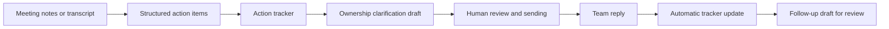

# Customer Operations & AI Automation Portfolio

I build practical AI workflows around customer-facing work: understanding requests, keeping track of actions and making follow-up easier to manage.

This portfolio presents two projects built with n8n and OpenAI. It describes their purpose, behavior and limitations. The complete implementations remain private.

## Meeting Assistant — Task Ownership Follow-up

### The problem
Meeting notes can record an action without establishing who will take responsibility. Extracting a task does not resolve missing or disputed ownership.

### What I built
I extended an initial meeting-summary assistant into a task ownership workflow. It extracts action items from meeting notes or transcripts, records them in Google Sheets and prepares clarification drafts for the appropriate team when an individual owner is missing.

Email replies can then be processed to update the action tracker. Confirmation or further clarification messages are prepared as drafts for human review.

### Behaviors exercised in development
- Recording tasks with confirmed owners and tasks needing clarification.
- Routing clarification to a configured team recipient.
- Processing a new ownership confirmation.
- Handling explicit ownership withdrawal and replies with no ownership update.
- Skipping previously processed messages and avoiding repeated task entries in tested scenarios.
- Recording generated drafts and processed replies for traceability.

### Project progression
**Version 1:** meeting summaries, decisions, action items and follow-up drafts.

**Version 2:** ownership clarification, email reply processing, automatic action-tracker updates and recovery checks.

### Tools
n8n, OpenAI, Gmail and Google Sheets.

### Limits
This is a portfolio prototype demonstrated with fictional scenarios. AI interpretation can be wrong. Outgoing emails remain drafts for human review; tracker updates occur automatically after classification. Testing does not establish production reliability or guarantee that every failure, duplicate or ambiguous reply is handled. There is no claim of measured business savings or a live customer deployment.

## Customer Success AI Copilot

### The problem
Answering an account question can require finding customer information and reviewing related orders across records.

### What I built
A conversational assistant that retrieves customer and order information from structured tables and uses it to help answer account-related questions.

### Tools
n8n, OpenAI and n8n Data Tables.

### Limits
The demonstration uses fictional data. Answers and calculations require review. The prototype is not a production customer-data service and does not independently establish customer satisfaction or churn risk.

## My contribution
I built and iterated on the workflows, configured the integrations and structured outputs, developed the ownership-handling rules, investigated failures and tested the main scenarios. These projects combine my customer-facing experience with practical learning in AI and workflow automation.

## What is shared here
This repository contains a public project presentation only. Workflow exports, prompts, executable code, detailed configuration, credentials, private correspondence and execution records are not included. No rights to the private implementation are granted by this presentation.

A supervised demonstration can be discussed during a recruitment conversation. Access to private implementation material is considered separately.
